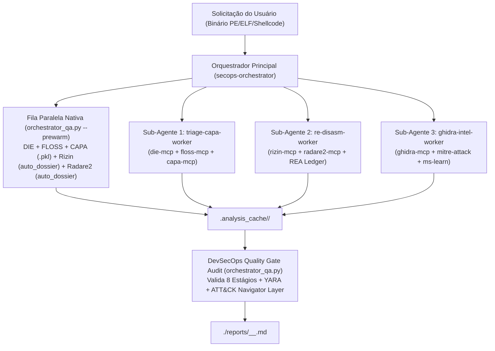

# Orquestrador DevSecOps & SecOps de Sub-Agentes (`secops-orchestrator`)

## Visão Geral e Papel
O **`secops-orchestrator`** atua como um Especialista Principal em Segurança da Informação, DevSecOps e Engenharia de Software responsável por coordenar a fila de execução de análise estática no FlareVM. Ele garante:
1. **Alta Velocidade (2x a 4x mais rápido)**:
   - Pré-aquecimento paralelo em `ThreadPoolExecutor` (`die-mcp`, `floss-mcp`, `capa-mcp` com cache `.pkl` em disco/memória, `rizin-mcp` com `auto_dossier=True` e `radare2-mcp` com `auto_dossier=True`) via [`orchestrator_qa.py`](file:///C:/Users/keyokemona/agy_dir/src/flare_re_mcp/orchestrator_qa.py).
   - Despacho paralelo (*Fan-Out / Fan-In*) de sub-agentes especializados (`triage-capa-worker`, `re-disasm-worker`, `ghidra-intel-worker`).
2. **Garantia Total de Qualidade (8-Point Quality Gate)**:
   - Nenhuma análise é dada como concluída sem que todos os 8 estágios (`1_die_triage`, `2_floss_strings`, `3_capa_capabilities`, `4_rizin_re`, `5_radare2_re`, `6_ghidra_decompiler`, `7_rea_evidence_ledger`, `8_deliverables_and_reports`) retornem `"overall_quality_gate": "PASSED"`.

---

## Arquitetura da Fila de Sub-Agentes



---

## Passo a Passo de Execução do Orquestrador

### Passo 1: Definir (se necessário na sessão atual) ou Invocar os Sub-Agentes
Caso os sub-agentes ainda não tenham sido definidos na sessão atual do `agy`, defina-os com `define_subagent`:
- `secops-orchestrator` (`enable_mcp_tools=True`, `enable_subagent_tools=True`, `enable_write_tools=True`)
- `triage-capa-worker` (`enable_mcp_tools=True`, `enable_write_tools=True`)
- `re-disasm-worker` (`enable_mcp_tools=True`, `enable_write_tools=True`)
- `ghidra-intel-worker` (`enable_mcp_tools=True`, `enable_write_tools=True`)

### Passo 2: Executar a Fila Paralela + Sub-Agentes Simultaneously
1. Execute o pré-aquecimento paralelo de alta velocidade (conclui os 5 primeiros servidores nativos em ~3–5 segundos):
   ```powershell
   python -m flare_re_mcp.orchestrator_qa "<CAMINHO_DO_BINARIO>" --prewarm
   ```
2. Em paralelo, acione `ghidra-intel-worker` (ou os 3 workers via `invoke_subagent`) para realizar a decompilação profunda no Ghidra (`ghidra_open_and_analyze` com `auto_decompile_top=True`, `ghidra_annotate_with_capa`, `ghidra_synthesize_multi_tool_report`) e o enriquecimento no `mitre-attack` (`get_technique_by_id`, `get_mitigations_mitigating_technique`, `get_datacomponents_detecting_technique`) e `ms-learn` (`microsoft_docs_search`).

### Passo 3: Gerar Artefatos de Detecção e Relatório Final
1. Registre todas as evidências verificadas em `.analysis_cache/<sha256>/ledger.json`.
2. Gere a camada do MITRE ATT&CK Navigator em `.analysis_cache/<sha256>/attack_navigator_layer.json`.
3. Gere e valide a regra YARA em `.analysis_cache/<sha256>/<nome>.yar`.
4. Gere o relatório estático completo e salve-o tanto no diretório de artefatos da conversa quanto em:
   `./reports/<YYYY-MM-DD_HH-MM-SS>_<nome_do_arquivo>_<sha256[:12]>.md`.

### Passo 4: Auditoria Obrigatória de Quality Gate e Sintaxe Mermaid
1. **Regras Estritas de Sintaxe Mermaid nos Relatórios Markdown**:
   - **Proibido usar `\"` dentro de rótulos Mermaid `["..."]`**: O parser do Mermaid interpreta `\"` como fechamento prematuro do nó. Utilize sempre a entidade **`#quot;`** (ex.: `Del /f /q #quot;%s#quot;`) ou aspas simples (`'...'`).
   - **Proibido usar non-breaking spaces (`\u00A0`)** na indentação e jamais concatenar dois nós/setas na mesma linha (`..."]    FMT -->` deve ter quebra de linha antes de `FMT -->`).
2. Execute o auditor determinístico (que também sanitiza blocos Mermaid automaticamente):
```powershell
python -m flare_re_mcp.orchestrator_qa "<CAMINHO_DO_BINARIO>" --artifact-report "<CAMINHO_DO_RELATORIO_MD>"
```
Verifique que `"overall_quality_gate": "PASSED"` e `"all_checks_passed": true` antes de apresentar o resultado final ao usuário.

