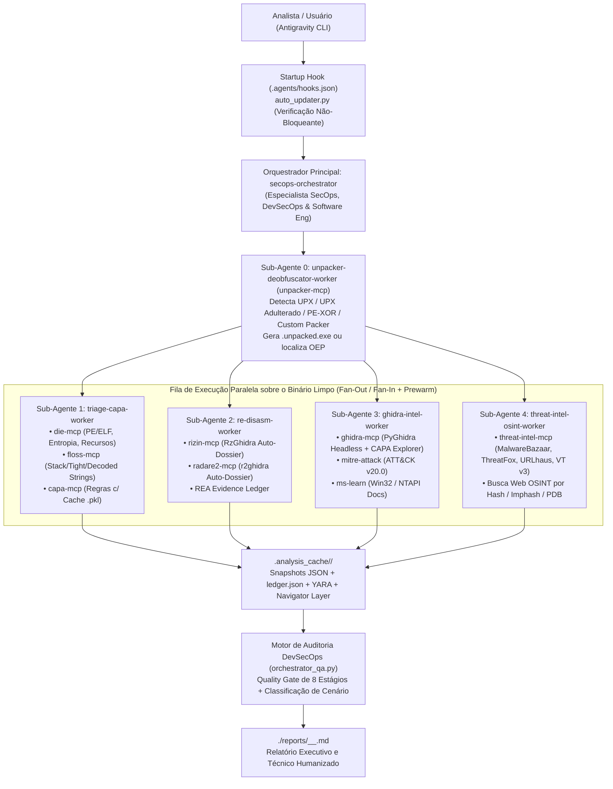

# 🛡️ Flare-RE-MCP — Universal Multi-MCP Static Malware Analysis & Reverse Engineering Suite

[](https://github.com/mandiant/flare-vm)
[](https://www.python.org/)
[](https://modelcontextprotocol.io/)
[](https://attack.mitre.org/)
[](https://github.com/MBCProject/mbc-markdown)
[](./src/flare_re_mcp/orchestrator_qa.py)

**`flare-re-mcp`** é uma suíte open-source e multi-plataforma de **Análise Estática Avançada de Binários, Desempacotamento Híbrido, Threat Intelligence OSINT e Mentoria em Engenharia Reversa** projetada para funcionar com **zero atrito** tanto no **FlareVM (Mandiant)** quanto em qualquer máquina **Windows 10/11 padrão**, **Linux (Ubuntu, Kali, REMnux, Debian, Arch, Fedora, WSL2)** ou **Docker**, integrada nativamente ao **Antigravity CLI (`agy`)**.

> 💡 **Filosofia do Projeto**: *"Basta executar os poucos comandos abaixo, abrir o `agy` com o `mcp_config.json` já configurado automaticamente para você e pronto: seu ambiente de análise estática avançada automatizado com um multi-MCP agêntico está pronto para te ajudar nas análises de malware do dia a dia — com total transparência sobre o processamento, evidências coletadas e relatórios gerados."*

---

## ⚡ Quickstart em 3 Comandos ("Zero-Friction Setup")

### Opção A — Windows (FlareVM ou Windows 10/11 Padrão)
```powershell
git clone <URL_DO_REPOSITORIO> flare-re-mcp
cd flare-re-mcp
powershell -ExecutionPolicy Bypass -File .\scripts\install.ps1
agy
```

### Opção B — Linux / REMnux / Kali / Ubuntu / WSL2
```bash
git clone <URL_DO_REPOSITORIO> flare-re-mcp
cd flare-re-mcp
chmod +x ./scripts/install.sh && ./scripts/install.sh
agy
```

### Opção C — Universal via Python (Qualquer Sistema Operacional)
```bash
python install.py --download-missing
agy
```

### Opção D — Via Container Docker (Isolamento Completo)
```bash
docker compose up --build -d
docker exec -it flare-re-mcp-suite python3 -m flare_re_mcp.orchestrator_qa /workspace/samples/Malware.Unknown.exe.malz --prewarm
```

---

## 📑 Sumário

1. [Visão Geral e Filosofia de Engenharia](#-1-visão-geral-e-filosofia-de-engenharia)
2. [Estimativa de Tempo de Análise por Cenário Técnico de Malware](#-2-estimativa-de-tempo-de-análise-por-cenário-técnico-de-malware)
3. [Arquitetura Multi-MCP e Orquestração de Sub-Agentes](#-3-arquitetura-multi-mcp-e-orquestração-de-sub-agentes)
4. [Catálogo dos 10 Servidores MCP e Ferramentas Expostas](#-4-catálogo-dos-10-servidores-mcp-e-ferramentas-expostas)
5. [Módulo de Aprendizado Prático & Mentor Offline (`flare-re-mentor`)](#-5-módulo-de-aprendizado-prático--mentor-offline-flare-re-mentor)
6. [Auto-Update na Inicialização (`flare-re-update`) & Desinstalação Limpa (`UNINSTALL.md`)](#-6-auto-update-na-inicialização-flare-re-update--desinstalação-limpa-uninstallmd)
7. [Mapa Completo de Diretórios do Repositório](#-7-mapa-completo-de-diretórios-do-repositório)
8. [Créditos e Referências Técnicas](#-8-créditos-e-referências-técnicas)

---

## 🎯 1. Visão Geral e Filosofia de Engenharia

O **`flare-re-mcp`** unifica **8 servidores MCP próprios** (`die-mcp`, `unpacker-mcp`, `floss-mcp`, `capa-mcp`, `rizin-mcp`, `radare2-mcp`, `ghidra-mcp`, `threat-intel-mcp`) com **2 servidores MCP de Inteligência e Documentação Oficial** (`mitre-attack` e `ms-learn`), coordenados por um **Orquestrador DevSecOps & SecOps Multi-Agente (`secops-orchestrator`)** e um **Ledger de Evidências Forenses (REA Evidence Ledger)**.

Seis pilares garantem precisão forense, velocidade e resiliência:
* **Desempacotamento Híbrido (`unpacker-mcp` + `unpacker-deobfuscator-worker`)**: Detecta e descomprime automaticamente wrappers conhecidos (**UPX**, **UPX com cabeçalho/seções adulteradas**, **PEs embutidos em recursos/overlay** e **payloads cifrados com XOR**), redirecionando os demais agentes para analisar o novo binário limpo (`.unpacked.exe`), ou pergunta ao usuário antes de criar um desempacotador manual para packers customizados.
* **Threat Intelligence OSINT OPSEC-Safe (`threat-intel-mcp` + `threat-intel-osint-worker`)**: Consulta **MalwareBazaar**, **ThreatFox**, **URLhaus** e **VirusTotal v3** estritamente por hashes (`SHA-256`, `MD5`, `Imphash`) e IOCs — sem jamais fazer upload da amostra — e complementa com busca web OSINT.
* **Isolamento de `stderr` e Segurança (`kd992102/rizin-mcp`)**: Proteção C-level (`os.dup2` em `suppress_stderr()`) para que avisos da JVM/C++ nunca quebrem o protocolo JSON-RPC `stdio`.
* **Disciplina Epistemológica (`morluto/rea`)**: Separação estrita em `.analysis_cache/<sha256>/ledger.json` entre **Observações Verificadas** (*Verified Observations* ancoradas em endereços `0x...`), **Inferências Analíticas** (*Inferences*) e **Incógnitas Residuais** (*Residual Unknowns*).
* **Tripla Validação de Decompilação**: Cruzamento simultâneo do pseudocódigo C gerado por **`rz-ghidra`** (Rizin), **`r2ghidra`** (Radare2 com `bin.relocs.apply=true`) e **`DecompInterface` nativo do Ghidra** (via `PyGhidra`).
* **Modo Mentor Socrático & Laboratório 100% Offline (`flare-re-mentor`)**: Permite ao analista aprender passo a passo por pistas progressivas dentro do `agy` ou diretamente no terminal (sem consumir tokens e sem precisar de internet).

---

## ⏱️ 2. Estimativa de Tempo de Análise por Cenário Técnico de Malware

Graças ao pré-aquecimento paralelo em `ThreadPoolExecutor` (`--prewarm`), ao cache binário `.pkl` das regras CAPA (`0.12s`) e ao modo *One-Shot Auto-Dossier*, o tempo total de análise estática varia conforme as técnicas de proteção presentes no artefato:

| Cenário Técnico do Binário Analisado | Técnicas / Características Típicas | Tempo na Fila Rápida Paralela *(DIE + Unpacker + TI + FLOSS + CAPA + Rizin + r2)* | Tempo de Decompilação Profunda *(Ghidra Headless + MITRE + MS-Learn)* | Tempo Total Estimado *(Ponta a Ponta c/ Relatório & YARA)* |
| :--- | :--- | :---: | :---: | :---: |
| **1. Binário Nativo Limpo (Sem Packer)** | Droppers, Downloaders HTTP, Backdoors C/C++ sem compressão de seções (ex.: `Malware.Unknown.exe.malz`). | **`~4s – 7s`** | `~12s – 25s` | **`~20s – 35s`** |
| **2. Binário Empacotado / Comprimido (Packer Conhecido ou Adulterado)** | **UPX padrão**, **UPX modificado** (cabeçalho `UPX0`/`UPX1` apagado), **PyInstaller** ou **PE/XOR embutido em `.rsrc`/overlay**. Inclui descompressão automática pelo `unpacker-mcp` + reanálise do payload limpo. | **`~6s – 12s`**<br/>*(inclui `unpack_auto_decompress`)* | `~15s – 30s` | **`~25s – 45s`** |
| **3. Binário com Forte *Defense Evasion* & Ofuscação de Strings** | *Stack strings*, *tight strings*, rotinas de decodificação XOR/RC4 em memória, resolução dinâmica de APIs (`LoadLibrary` + `GetProcAddress` / API Hashing) e auto-deleção (`T1070.004`). | **`~8s – 18s`**<br/>*(emulação de decoders no FLOSS)* | `~18s – 30s` | **`~30s – 50s`** |
| **4. Binário com *Anti-Debugging* & *Sandbox Evasion*** | `IsDebuggerPresent`, `CheckRemoteDebuggerPresent`, `NtQueryInformationProcess`, inspeção direta de `PEB.BeingDebugged`, *TLS Callbacks* antes de `main` e atrasos temporais (`RDTSC`, `Sleep`, `ping`). | **`~8s – 15s`** | `~20s – 35s`<br/>*(inspeção de TLS + XREFs)* | **`~35s – 55s`** |
| **5. Binário com *Anti-Disassembly*, *Control-Flow Flattening* ou Packer Customizado** | Predicados opacos, *junk bytes*, saltos no meio de instruções (`jz +1`), *Import Address Table* oculta ou packers comerciais/customizados (*ASPack*, *MPRESS*, *VMProtect*) com busca de *OEP*. | **`~10s – 20s`**<br/>*(inclui busca de `OEP` / `popad` + `tail jump`)* | `~45s – 90s`<br/>*(caso o usuário opte por gerar unpacker Python customizado)* | **`~55s – 110s`** |

> 📌 **Classificação Automática no Quality Gate**: Ao executar `python -m flare_re_mcp.orchestrator_qa "<binario>"`, o campo `"analysis_time_estimation_by_scenario"` identifica automaticamente em quais dos 5 cenários acima o binário analisado se enquadra!

---

## 🏗️ 3. Arquitetura Multi-MCP e Orquestração de Sub-Agentes



---

## 🧰 4. Catálogo dos 10 Servidores MCP e Ferramentas Expostas

| Servidor MCP | Entrypoint CLI / Módulo | Ferramentas Expostas (Tools) | Destaques Técnicos |
| :--- | :--- | :--- | :--- |
| **`die-mcp`** | `die-mcp`<br/>`flare_re_mcp.die_server` | • `die_scan_binary`<br/>• `die_check_packing_and_entropy`<br/>• `die_inspect_resources`<br/>• `die_extract_resource` | Combina `diec -j -d` com inspeção profunda `pefile` (Imphash, Rich Header, entropia de Shannon por seção, detecção de RWX, TLS callbacks, overlay e extração de payloads ocultos em `.rsrc`). |
| **`unpacker-mcp`** | `unpacker-mcp`<br/>`flare_re_mcp.unpacker_server` | • `unpack_inspect_and_detect`<br/>• `unpack_auto_decompress`<br/>• `unpack_find_oep_and_stub_landmarks` | **Novo!** Descompacta automaticamente UPX, UPX com cabeçalhos/seções adulteradas (`UPX0`/`UPX1` restaurados), PEs embutidos e payloads XOR de 1 byte, ou localiza candidatos a *OEP* (`pushad`/`popad` + `tail jump`). |
| **`threat-intel-mcp`** | `threat-intel-mcp`<br/>`flare_re_mcp.threat_intel_server` | • `ti_lookup_binary_reputation`<br/>• `ti_lookup_iocs` | **Novo!** Consulta **MalwareBazaar**, **ThreatFox**, **URLhaus** e **VirusTotal v3** estritamente por hashes (`SHA-256`, `MD5`, `Imphash`) e IOCs de rede, sem fazer upload do arquivo binário (100% OPSEC-safe). |
| **`floss-mcp`** | `floss-mcp`<br/>`flare_re_mcp.floss_server` | • `floss_extract_strings`<br/>• `floss_get_job_status`<br/>• `floss_get_obfuscated_strings_and_decoders`<br/>• `floss_search_strings` | Executa o Mandiant FLOSS em modo JSON (`-j`), extraindo strings estáticas (ASCII/UTF-16LE), *stack strings*, *tight strings*, *decoded strings*, scores de funções decodificadoras e categorizando IOCs via regex. |
| **`capa-mcp`** | `capa-mcp`<br/>`flare_re_mcp.capa_server` | • `capa_analyze_binary`<br/>• `capa_get_job_status`<br/>• `capa_inspect_rule_matches`<br/>• `capa_correlate_mitre_and_apis`<br/>• `capa_bulk_analyze` | Suporta 3 backends (`rizin`, `vivisect`, `ghidra`), cache binário `.pkl` das regras oficiais (`v9.4.0`), matriz MITRE ATT&CK + MBC e análise em lote multithread (`capa_bulk_analyze`). |
| **`rizin-mcp`** | `rizin-mcp`<br/>`flare_re_mcp.rizin_server` | • `open_and_analyze` (`auto_dossier=True`)<br/>• `analyze_function_dossier`<br/>• `decompile_function` (`pdg`)<br/>• `disassemble_function` (`pdf`)<br/>• `get_xrefs` / `find_import_callers`<br/>• `search_imports` / `search_strings`<br/>• `run_capa_analysis` / `get_capa_status`<br/>• `record_investigation_evidence`<br/>• `execute_rizin_command` / `close_file` | Baseado em `kd992102/rizin-mcp` e enriquecido com dossiês compostos (`morluto/rea`), compatibilidade com Rizin 0.9+ (`%v` e `?v`) e configuração automática do plugin `rz-ghidra` Sleigh. |
| **`radare2-mcp`** | `radare2-mcp`<br/>`flare_re_mcp.radare2_server` | • `r2_open_and_analyze` (`auto_dossier=True`)<br/>• `r2_decompile_function` (`pdg`)<br/>• `r2_disassemble_function`<br/>• `r2_list_functions`<br/>• `r2_list_imports_and_exports`<br/>• `r2_get_xrefs` / `r2_get_call_graph`<br/>• `r2_calculate` / `r2_execute_command`<br/>• `r2_close_file` | Opera o `radare2` com `bin.relocs.apply=true`, `bin.cache=true` e decompilador nativo `r2ghidra` para dupla verificação independente do código C decompilado. |
| **`ghidra-mcp`** | `ghidra-mcp`<br/>`flare_re_mcp.ghidra_server` | • `ghidra_open_and_analyze` (`auto_decompile_top=True`)<br/>• `ghidra_list_functions`<br/>• `ghidra_decompile_functions` (batch `;`)<br/>• `ghidra_get_xrefs`<br/>• `ghidra_annotate_with_capa`<br/>• `ghidra_synthesize_multi_tool_report`<br/>• `ghidra_close_program` | Inicia a JVM Headless via `PyGhidra`, persiste o projeto em `ghidra_projects/<sha256>`, cruza regras CAPA com funções do Ghidra (`capa_explorer`) e sintetiza o relatório multi-ferramenta. |
| **`mitre-attack`** | Servidor Local / STIX 2.1 | `get_technique_by_id`, `get_mitigations_mitigating_technique`, `get_datacomponents_detecting_technique`, `get_layer_metadata`, `generate_layer` | Enriquecimento oficial de Threat Intelligence (**MITRE ATT&CK v20.0** — Enterprise, Mobile & ICS). |
| **`ms-learn`** | `https://learn.microsoft.com/api/mcp` | `microsoft_docs_search`, `microsoft_docs_fetch`, `microsoft_code_sample_search` | Documentação oficial da Microsoft em tempo real para APIs Win32, NTAPI, estruturas e flags hexadecimais. |

### 4.1 Matriz de Versões dos Frameworks, Taxonomias e Motores Integrados

| Framework / Motor / Taxonomia | Versão Utilizada | Papel na Correlação e Elaboração de Relatórios |
| :--- | :---: | :--- |
| **MITRE ATT&CK® (STIX 2.1 Dataset)** | **`v20.0`** *(Enterprise, Mobile, ICS)* | Base oficial consultada pelo servidor `mitre-attack` (`~/.mitre-mcp-server/data/v20.0/`) para técnicas (`Txxxx`), mitigações (`Mxxxx`), grupos (`Gxxxx`), softwares (`Sxxxx`) e componentes de detecção. |
| **MITRE ATT&CK® Navigator & Layer Schema** | **Navigator `v5.1.0` / Layer `v4.5` (ATT&CK `v20`)** | Formato JSON utilizado para gerar `attack_navigator_layer.json` compatível com o ATT&CK v20.0. |
| **MITRE MBC (Malware Behavior Catalog)** | **`v3.3`** | Taxonomia comportamental específica para engenharia reversa de malwares correlacionada via `capa-mcp`. |
| **Mandiant CAPA (`flare-capa` & `capa-rules`)** | **Engine Python `v10.0.0` / CLI & Rules `v9.4.0`** | Avaliação de 997 regras oficiais (1.385 regras totais compiladas em `.pkl`) nos backends `rizin`, `vivisect` e `ghidra`. |
| **Mandiant FLOSS (`floss-mcp`)** | **`v3.1.1`** | Extração e emulação estática de *decoded strings*, *stack strings*, *tight strings* e strings estáticas ASCII/UTF-16LE. |
| **Detect It Easy (`die-mcp`) + `pefile`** | **DIE `v3.10` / `pefile v2024.8.26`** | Identificação de compiladores, empacotadores (packers), Imphash, entropia de Shannon e extração de recursos `.rsrc`. |
| **UPX & Deobfuscator (`unpacker-mcp`)** | **UPX `v4.x` + Reparo PE Customizado** | Descompressão automática de UPX, restauração de seções `UPX0`/`UPX1` adulteradas e extração de PEs/XOR embutidos. |
| **Rizin + RzGhidra (`rizin-mcp`)** | **Rizin `v0.9.1` (Cutter `v2.5.0`)** | Disassembly rápido, grafos de chamadas, dossiês REA e decompilação Sleigh via `rz-ghidra`. |
| **Radare2 + r2ghidra (`radare2-mcp`)** | **Radare2 `v6.2.4` + `r2ghidra v6.2.4`** | Segunda opinião independente de disassembly e decompilação C nativa com relocações aplicadas (`bin.relocs.apply=true`). |
| **NSA Ghidra + PyGhidra (`ghidra-mcp`)** | **Ghidra `v12.1.4 PUBLIC` / PyGhidra `v3.1.0`** | Decompilação avançada com recuperação de tipos via `DecompInterface` (OpenJDK 21 Headless) e anotação estilo `capa_explorer.py`. |
| **YARA (`yara-python`)** | **`v4.5.4`** | Compilação e validação automatizada de regras de detecção (strings + imports PE + opcodes) no estágio 8 do Quality Gate. |
| **Abuse.ch & VirusTotal (`threat-intel-mcp`)** | **API v1 / v3 (Live OSINT)** | Consulta de reputação por hash/IOC no MalwareBazaar, ThreatFox, URLhaus e VirusTotal v3. |
| **Microsoft Learn (`ms-learn`)** | **Live API (`learn.microsoft.com`)** | Consulta sempre atualizada da documentação oficial da Microsoft (Win32 API, NTAPI, `wininet.h`, `urlmon.h`, `processthreadsapi.h`). |

---

## 🎓 5. Módulo de Aprendizado Prático & Mentor Offline (`flare-re-mentor`)

Para capacitar o analista a dominar as ferramentas de linha de comando e reproduzir toda a análise manualmente (mesmo quando estiver sem tokens, sem acesso ao `agy` ou em um laboratório *air-gapped* totalmente isolado):

### 5.1 Dentro do Antigravity CLI (`agy`)
Basta incluir palavras-chave como `/treino`, `/mentor`, `modo aprendizado` ou `me dê pistas` no seu prompt:
```text
/treino Quero aprender a analisar o binário C:\Users\keyokemona\Desktop\Malware.Unknown.exe.malz passo a passo, me dê pistas!
```
O agente ativará a skill [`static-analysis-mentor`](./.agents/skills/static-analysis-mentor/SKILL.md) e guiará sua investigação em **4 Níveis Progressivos** (Triagem PE → Strings/IOCs → Capacidades CAPA → Decompilação C/Assembly & YARA), sem entregar spoilers iniciais!

### 5.2 Diretamente no Terminal (100% Offline e Zero Consumo de Tokens)
```powershell
# Sessão interativa passo a passo no terminal (sem usar o agy):
python -m flare_re_mcp.mentor_engine "C:\Users\keyokemona\Desktop\Malware.Unknown.exe.malz" --interactive

# Consultar apenas o Nível 1 com Pista (sem revelar o gabarito):
python -m flare_re_mcp.mentor_engine "C:\Users\keyokemona\Desktop\Malware.Unknown.exe.malz" --level 1 --show-hint

# Gerar Caderno Prático de Laboratório em ./reports/LAB_MENTOR_*.md (com dicas e gabaritos ocultos em blocos clicáveis <details>):
python -m flare_re_mcp.mentor_engine "C:\Users\keyokemona\Desktop\Malware.Unknown.exe.malz" --export-lab-guide
```

---

## 🔄 6. Auto-Update na Inicialização (`flare-re-update`) & Desinstalação Limpa (`UNINSTALL.md`)

### 6.1 Verificação Automática e Auto-Update ([`auto_updater.py`](./src/flare_re_mcp/auto_updater.py))
* Sempre que o `agy` inicia nesta pasta, o hook configurado em [`.agents/hooks.json`](./.agents/hooks.json) executa `python -m flare_re_mcp.auto_updater --startup-hook` (com cache de cooldown de 12h para não atrasar a abertura).
* Para verificar versões remotas no GitHub e atualizar todas as dependências, regras CAPA e binários portáteis a qualquer momento:
  ```powershell
  python -m flare_re_mcp.auto_updater --update-all
  ```

### 6.2 Desinstalação Completa Sem Resquícios ([`UNINSTALL.md`](./UNINSTALL.md) & [`uninstall.py`](./uninstall.py))
* Para remover todos os servidores MCP do `~/.gemini/config/mcp_config.json`, apagar caches `.analysis_cache/`, `ghidra_projects/`, ferramentas portáteis `~/.flare-re-mcp/`, variáveis de ambiente e pacotes Python:
  ```powershell
  python uninstall.py --full-purge
  ```
* Consulte o manual completo em **[`UNINSTALL.md`](./UNINSTALL.md)**.

---

## 📂 7. Mapa Completo de Diretórios do Repositório

| Diretório / Arquivo | Descrição | Documentação Dedicada |
| :--- | :--- | :--- |
| **`/` (Raiz)** | Instalador ([install.py](./install.py)), desinstalador ([uninstall.py](./uninstall.py)), manual de remoção ([UNINSTALL.md](./UNINSTALL.md)), containers ([Dockerfile](./Dockerfile)) e regras ([AGENTS.md](./AGENTS.md)). | [README.md](./README.md) \| [UNINSTALL.md](./UNINSTALL.md) |
| **[`scripts/`](./scripts/)** | Instaladores automatizados de 1 comando para Windows (`install.ps1`) e Linux/WSL2 (`install.sh`). | [scripts/README.md](./scripts/README.md) |
| **[`src/`](./src/)** | Camada de código-fonte seguindo o layout moderno `src-layout` (PEP 517/621). | [src/README.md](./src/README.md) |
| **[`src/flare_re_mcp/`](./src/flare_re_mcp/)** | Implementação dos 8 servidores MCP locais, `auto_updater.py`, `mentor_engine.py` e `orchestrator_qa.py`. | [src/flare_re_mcp/README.md](./src/flare_re_mcp/README.md) |
| **[`.agents/`](./.agents/)** | Customizações e hooks (`hooks.json`) do Antigravity CLI para descoberta automática no workspace. | [.agents/README.md](./.agents/README.md) |
| **[`.agents/skills/`](./.agents/skills/)** | Catálogo das 4 *skills* especializadas (`secops-orchestrator`, `flare-static-analysis`, `binary-unpacker-deobfuscator`, `static-analysis-mentor`). | [.agents/skills/README.md](./.agents/skills/README.md) |
| **[`reports/`](./reports/)** | Repositório central de relatórios finais de análise estática e cadernos de laboratório (`LAB_MENTOR_*.md`). | [reports/README.md](./reports/README.md) |
| **[`.analysis_cache/`](./.analysis_cache/)** | Cache endereçado por conteúdo (`<sha256>`), Ledger de Evidências (`ledger.json`), regras YARA e camadas ATT&CK Navigator. | [.analysis_cache/README.md](./.analysis_cache/README.md) |
| **[`ghidra_projects/`](./ghidra_projects/)** | Projetos Ghidra persistentes (`.gpr`/`.rep`) indexados por SHA-256 para reabertura instantânea na GUI ou via PyGhidra. | [ghidra_projects/README.md](./ghidra_projects/README.md) |
| **[`tests/`](./tests/)** | Suíte de testes de integração ponta a ponta para validação dos servidores MCP e ferramentas de CLI. | [tests/README.md](./tests/README.md) |
| **[`prompts/`](./prompts/)** | Especificações originais do projeto e biblioteca de templates de prompts para análise e modo treino. | [prompts/README.md](./prompts/README.md) |
| **[`reference/`](./reference/)** | Repositórios de referência estudados e integrados na concepção da arquitetura. | [reference/README.md](./reference/README.md) |

---

## 📚 8. Créditos e Referências Técnicas

* [`kd992102/rizin-mcp`](https://github.com/kd992102/rizin-mcp) — Gerenciamento de sessão Rizin via `rzpipe`, extrator rápido de features para o CAPA (`RizinFeatureExtractor`) e proteção de descritores `stderr`.
* [`morluto/rea`](https://github.com/morluto/rea) — Arquitetura de *Reverse Engineering Assistant*, dossiês compostos de funções e separação epistemológica no *Evidence Ledger*.
* [`radareorg/radare2-mcp`](https://github.com/radareorg/radare2-mcp) — Modelagem de ferramentas para inspeção via `r2pipe` e `r2ghidra`.
* [`bethington/ghidra-mcp`](https://github.com/bethington/ghidra-mcp) — Decompilação em lote e inspeção de referências cruzadas no Ghidra.
* [`mandiant/capa`](https://github.com/mandiant/capa) — `bulk-process.py` e `capa_explorer.py` (anotação de capacidades comportamentais no Ghidra).
