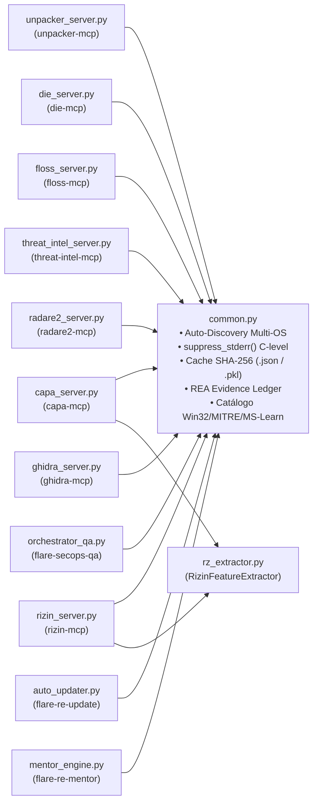

# ⚙️ Pacote `flare_re_mcp` — Núcleo dos Servidores MCP, Desempacotador, Threat Intel e Mentor

Este diretório contém toda a implementação dos **8 servidores MCP locais de análise estática e Threat Intelligence** (que operam em conjunto com `mitre-attack` e `ms-learn`, totalizando **10 servidores MCP**), o motor de **cache SHA-256 e REA Evidence Ledger**, o **auto-updater de inicialização (`auto_updater.py`)**, o **módulo de aprendizado socrático (`mentor_engine.py`)** e o **motor de fila paralela e auditoria de Quality Gate (`orchestrator_qa.py`)**.

---

## 🗺️ Arquitetura dos Módulos

---

## 📄 Descrição Detalhada de Cada Arquivo

### 1. [`common.py`](./common.py) — Infraestrutura Compartilhada, Auto-Discovery Multi-OS, Cache e Cross-Enrichment
O alicerce de todos os servidores MCP:
* **Descoberta Automática Multiplataforma (`_first_existing_path`)**: Localiza `diec`, `floss`, `capa`, `rizin` + `rz-ghidra`, `radare2` + `r2ghidra`, `upx` e `Ghidra` (`GHIDRA_INSTALL_DIR`) automaticamente no **Windows FlareVM**, **Windows Padrão** (`~/.flare-re-mcp/tools/`), **Linux** (`/usr/bin`, `/opt/ghidra`) e **Docker**.
* **Isolamento de `stderr` (`suppress_stderr()`)**: Utiliza `os.dup` e `os.dup2` no descritor de arquivo `fd=2` para impedir que mensagens nativas em C/C++ (Rizin, Radare2) ou JVM (PyGhidra) quebrem o transporte `stdio` JSON-RPC do protocolo MCP.
* **Segurança e Sanitização (`resolve_binary_path` & `sanitize_symbol_or_address`)**: Previne *path traversal* e bloqueia *command injection* em comandos passados ao `rzpipe`/`r2pipe`.
* **Cache de Snapshots SHA-256 (`save_tool_snapshot` / `load_tool_snapshot`)**: Persiste os resultados de cada ferramenta em `.analysis_cache/<sha256>/<tool>.json`.
* **Cache Binário `.pkl` do CAPA (`get_cached_capa_ruleset`)**: Compila as 997 regras YAML do CAPA em `.analysis_cache/_capa_ruleset_cache.pkl`, acelerando a carga de ~3,5s para **~0,12s**.
* **REA Evidence Ledger (`update_evidence_ledger`)**: Gerencia o arquivo `.analysis_cache/<sha256>/ledger.json` dividindo descobertas em `verified_observations`, `inferences` e `residual_unknowns`.
* **Enriquecimento Cross-MCP (`SUSPICIOUS_WIN32_APIS` & `classify_imports_for_mcp_enrichment`)**: Mapeia dezenas de APIs críticas do Windows para IDs do **MITRE ATT&CK v20.0** e queries prontas para o **Microsoft Learn (`ms-learn`)**.

---

### 2. [`unpacker_server.py`](./unpacker_server.py) — Servidor `unpacker-mcp` (Desempacotador e Desofuscador Híbrido)
Expõe 3 ferramentas MCP:
* `unpack_inspect_and_detect(file_path)`: Detecta packers conhecidos (`UPX`, **UPX Modificado/Tampered** com cabeçalhos ou nomes de seções adulterados como `.vmp0`/`CODE`, `PyInstaller`, `ASPack`, `MPRESS`, `VMProtect`, `Themida`) e escaneia por **PEs embutidos ou codificados via XOR** na imagem. Classifica a estratégia entre `not_packed`, `auto_supported` ou `custom_manual_requires_user_choice`.
* `unpack_auto_decompress(file_path, allow_header_repair=True)`: Repara automaticamente cabeçalhos/seções de binários UPX adulterados, executa `upx -d` ou extrai payloads PE/XOR para `.analysis_cache/<sha256>/unpacked/<nome>.unpacked.exe` e retorna o novo caminho e SHA-256 para que os demais agentes analisem o binário limpo.
* `unpack_find_oep_and_stub_landmarks(file_path)`: Caso o packer seja customizado/desconhecido, analisa o stub de entrada via Rizin em busca de pares `pushad`/`popad`, tail jumps (`jmp eax`, `push + ret`) e chamadas de alocação (`VirtualAlloc`/`VirtualProtect`) para auxiliar na escrita sob demanda de um desempacotador Python customizado.

---

### 3. [`threat_intel_server.py`](./threat_intel_server.py) — Servidor `threat-intel-mcp` (Threat Intelligence & OSINT Hash-Only)
Expõe 2 ferramentas MCP (100% OPSEC Safe — consulta apenas hashes e IOCs, **jamais faz upload do binário**):
* `ti_lookup_binary_reputation(file_path)`: Consulta os hashes `SHA-256`/`MD5`/`SHA-1` e `Imphash` no **MalwareBazaar (abuse.ch)**, **ThreatFox (abuse.ch)** e **VirusTotal v3** (se `VT_API_KEY` estiver configurada), além de gerar dorks OSINT estruturadas para pesquisa web de relatórios públicos de CTI.
* `ti_lookup_iocs(indicators_csv)`: Consulta listas de URLs, domínios, IPs e hashes extraídos pelo FLOSS no **ThreatFox** e **URLhaus (abuse.ch)**.

---

### 4. [`rz_extractor.py`](./rz_extractor.py) — Extrator Rápido de Features Rizin para o CAPA
Adaptado de `kd992102/rizin-mcp` e atualizado para `flare-capa`:
* Implementa a interface `capa.features.extractors.base_extractor.SampleHashes` e `StaticFeatureExtractor`.
* Extrai cabeçalhos PE, imports, exports, seções, funções, basic blocks e instruções diretamente da sessão `rzpipe` em memória.

---

### 5. [`die_server.py`](./die_server.py) — Servidor `die-mcp` (Detect It Easy + `pefile`)
Expõe 4 ferramentas MCP:
* `die_scan_binary`, `die_check_packing_and_entropy`, `die_inspect_resources`, `die_extract_resource`.

---

### 6. [`floss_server.py`](./floss_server.py) — Servidor `floss-mcp` (Mandiant FLOSS)
Expõe 4 ferramentas MCP:
* `floss_extract_strings`, `floss_get_job_status`, `floss_get_obfuscated_strings_and_decoders`, `floss_search_strings`.

---

### 7. [`capa_server.py`](./capa_server.py) — Servidor `capa-mcp` (Mandiant CAPA Multi-Backend)
Expõe 5 ferramentas MCP:
* `capa_analyze_binary`, `capa_get_job_status`, `capa_inspect_rule_matches`, `capa_correlate_mitre_and_apis`, `capa_bulk_analyze`.

---

### 8. [`rizin_server.py`](./rizin_server.py) — Servidor `rizin-mcp` (Rizin + RzGhidra + REA Dossiers)
Expõe 14 ferramentas MCP:
* `open_and_analyze`, `analyze_function_dossier`, `decompile_function`, `disassemble_function`, `list_functions`, `get_binary_info`, `search_imports`, `search_strings`, `get_xrefs`, `find_import_callers`, `run_capa_analysis`, `get_capa_status`, `record_investigation_evidence`, `execute_rizin_command`, `close_file`.

---

### 9. [`radare2_server.py`](./radare2_server.py) — Servidor `radare2-mcp` (Radare2 6.2.4 + `r2ghidra`)
Expõe 10 ferramentas MCP:
* `r2_open_and_analyze`, `r2_decompile_function`, `r2_disassemble_function`, `r2_list_functions`, `r2_list_imports_and_exports`, `r2_get_xrefs`, `r2_get_call_graph`, `r2_calculate`, `r2_execute_command`, `r2_close_file`.

---

### 10. [`ghidra_server.py`](./ghidra_server.py) — Servidor `ghidra-mcp` (Ghidra 12.1.4 + PyGhidra 3.1.0)
Expõe 7 ferramentas MCP:
* `ghidra_open_and_analyze`, `ghidra_decompile_functions`, `ghidra_annotate_with_capa`, `ghidra_synthesize_multi_tool_report`, `ghidra_list_functions`, `ghidra_get_xrefs`, `ghidra_close_program`.

---

### 11. [`orchestrator_qa.py`](./orchestrator_qa.py) — Motor de Fila Paralela, Estimativa de Tempo por Cenário & Quality Gate
* `prewarm_parallel_static_queue(file_path, run_ghidra=False)`: Executa `unpacker-mcp`, `die-mcp`, `floss-mcp`, `capa-mcp`, `threat-intel-mcp`, `rizin-mcp` e `radare2-mcp` simultaneamente em `ThreadPoolExecutor` (~4-6s).
* `estimate_analysis_time_by_scenario(file_path)`: Classifica automaticamente a amostra em 1 dos 5 cenários de complexidade (Nativo Limpo, Empacotado Conhecido, Evasão/Ofuscação de Strings, Anti-Debugging ou Anti-Disassembly/Packer Customizado) e calcula a estimativa de tempo de execução.
* `audit_execution_queue(file_path, artifact_report_path=None, sync_to_reports_dir=True)`: Audita os 8 estágios obrigatórios da fila, compila regras YARA, verifica `attack_navigator_layer.json` (v20.0) e arquiva o relatório final em `./reports/`.

---

### 12. [`auto_updater.py`](./auto_updater.py) — Verificador de Versões na Inicialização (`flare-re-update`)
* Acionado automaticamente na abertura do `agy` via `.agents/hooks.json` (`--startup-hook`) com cooldown de 12h.
* Verifica versões de pacotes Python (`flare-capa`, `flare-floss`, `pyghidra`, `rzpipe`, `r2pipe`, `pefile`, `yara-python`), binários nativos, regras CAPA e banco STIX do MITRE ATT&CK (`v20.0`), permitindo atualização automatizada com `flare-re-update --update-all`.

---

### 13. [`mentor_engine.py`](./mentor_engine.py) — Motor de Aprendizado Socrático Dual-Mode (`flare-re-mentor`)
* Gera um currículo prático de 4 níveis progressivos adaptado especificamente ao binário em estudo.
* Funciona tanto dentro do `agy` (via skill `static-analysis-mentor` e sub-agente `static-analysis-mentor-agent`) quanto **100% offline e zero-tokens no terminal** (`flare-re-mentor "<binario>" --interactive` ou `--export-lab-guide`).
